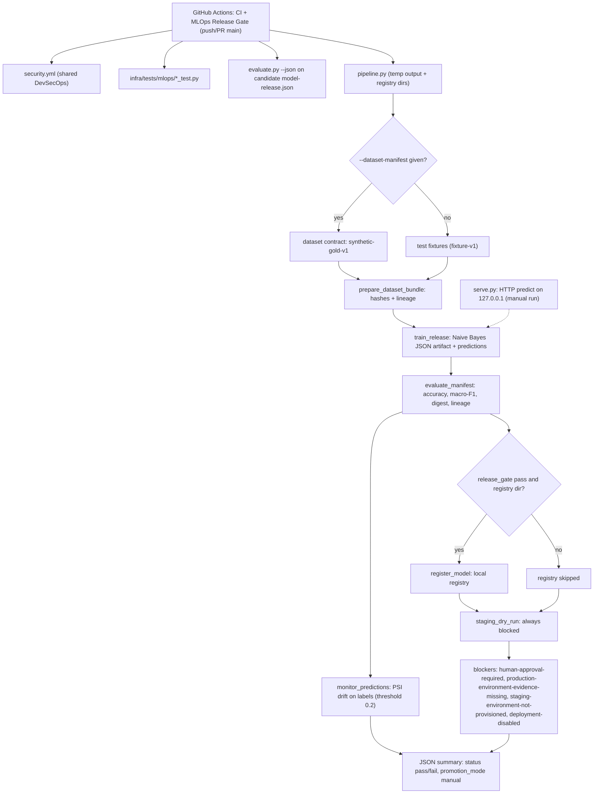
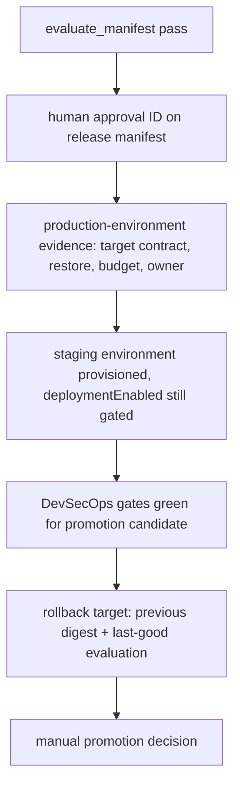

# 01 — Business process (As-Is / To-Be)

data-mlops-pipeline คือ reference pipeline MLOps แบบ local (stdlib เท่านั้น) ที่ owner ใช้พิสูจน์วงจร dataset → train → evaluate → registry → staging dry run → monitor พร้อม promotion gate ที่ fail closed ไม่มี deploy และไม่มีผู้ใช้ภายนอก

Last reviewed: 2026-11-28 · commit `ac21579`

## As-Is (จากโค้ดวันนี้)

Sources: `infra/scripts/mlops/pipeline.py`, `infra/scripts/mlops/evaluate.py`, `infra/scripts/mlops/staging.py`, `infra/scripts/mlops/monitor.py`, `infra/scripts/mlops/registry.py`, `infra/scripts/mlops/serve.py`, `.github/workflows/mlops.yml`, `PRODUCT.md`, `infra/mlops/README.md`

ข้อเท็จจริงจากโค้ด:

- `staging_dry_run` ตั้ง `staging_environment_provisioned: False` และ `deployment_disabled: True` ตายตัว จึง blocked เสมอ ไม่มีการแตะ GitOps หรือ cluster
- model `solo-empire-central-assistant` 0.2.0 อยู่ stage candidate; eval set มี 5 แถวสังเคราะห์ (`PRODUCT.md`)
- config Prometheus/Grafana ของ MLOps อยู่ใน repo `homelab` ไม่ได้อยู่ที่นี่ [ต้องยืนยัน] ว่ายังใช้งานอยู่

## To-Be (`infra/mlops/README.md` §Limitations and next activation gate)

Sources: `infra/mlops/README.md`, `PRODUCT.md` §Model and evaluation status

## Gap

| ID | As-Is → To-Be | Status | Owner | Evidence |
|---|---|---|---|---|
| G1 | ไม่มี `human_approval_id` ใน `model-release.json` → มี approval ID ของคน | decide | owner | `infra/mlops/README.md` gate 1; blocker `human-approval-required` ใน `evaluate.py` |
| G2 | ไม่มี production-environment evidence → มี target contract, restore, budget, owner | blocked | owner | `infra/mlops/README.md` gate 2; `staging.py` |
| G3 | staging ไม่ได้ provision (`staging_environment_provisioned: False` ตายตัว) → staging environment พร้อม gate | todo | owner | `infra/mlops/README.md` gate 3; `infra/scripts/mlops/staging.py` |
| G4 | `security.yml` รันใน CI ทุก push แต่ `evaluate.py` / `staging.py` ไม่อ่านผล → DevSecOps gates green เป็นเงื่อนไขของ promotion candidate | todo | claude | `infra/mlops/README.md` gate 4; `.github/workflows/ci.yml` job `security` |
| G5 | rollback ต้องมี version ก่อนหน้าใน registry ซึ่งมีแค่ 0.2.0 → rollback target พร้อม | todo | claude | `infra/mlops/README.md` gate 5; `registry.py` `rollback_target_available` |
| G6 | eval set 5 แถวสังเคราะห์ → eval set จากข้อมูลจริงที่ owner อนุมัติ | decide | owner | `PRODUCT.md` §Model and evaluation status (gap) |

## Open questions

- มี use case โมเดลจริงที่จะใช้ pipeline นี้หรือไม่ (`DOCPACK/00-product-card.md` §7 ระบุว่าจะเปลี่ยนเป็น `invest` เมื่อมี)
